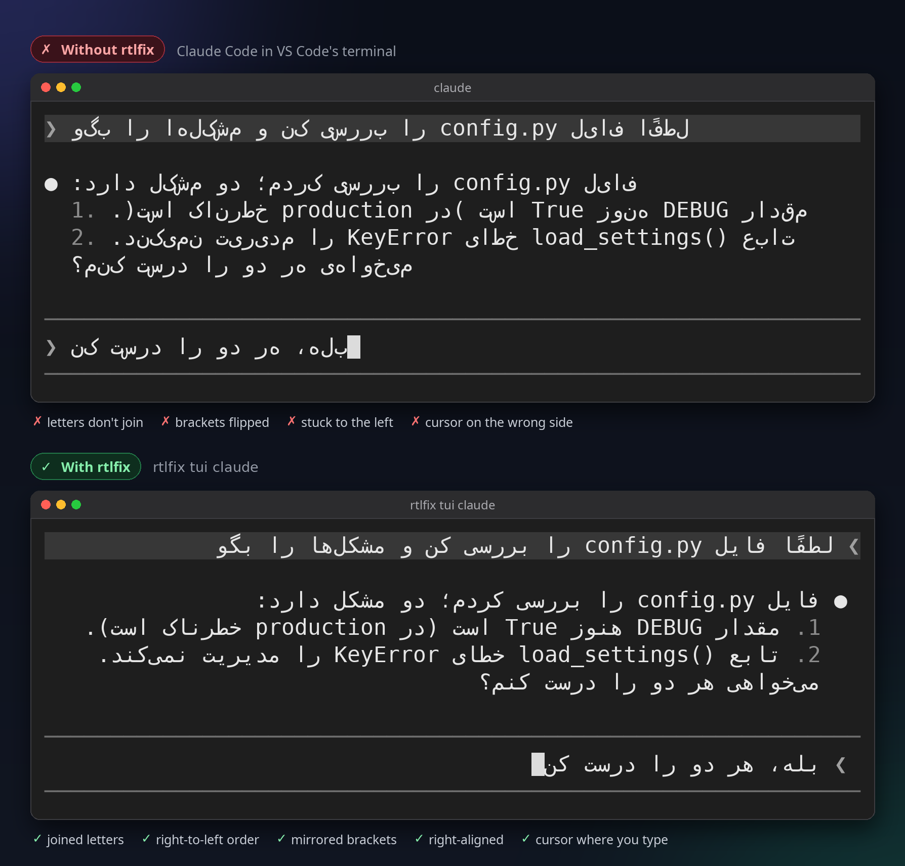
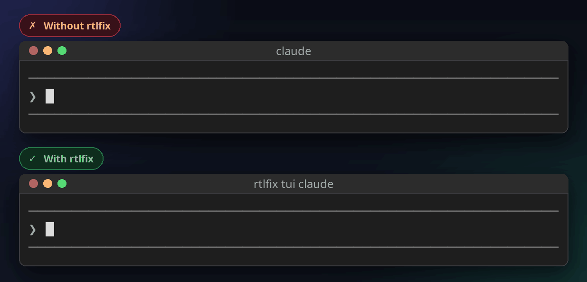

<div align="center">

# rtlfix

**Persian, Arabic and Hebrew that read right in your terminal AI agent.**

Claude Code, Qwen Code or any terminal program, in VS Code's integrated terminal<br>
and every other terminal that cannot draw right-to-left text.

[](https://github.com/VahidJbrl/rtlfix/actions/workflows/ci.yml)
[](LICENSE)
[](https://nodejs.org)




</div>

## Quick start

```bash
npm install -g github:VahidJbrl/rtlfix
rtlfix claude
```

That's all, on Linux, WSL and Windows. Use `rtlfix qwen` for Qwen Code, or `rtlfix tui <program>` for any other terminal program.

Not sure whether your terminal needs it? Run `rtlfix demo`.

<div dir="rtl">

**به فارسی:** rtlfix متن فارسی، عربی و عبری را در ترمینال VS Code و ترمینال‌های مشابه درست نمایش می‌دهد: حروف به هم می‌چسبند، ترتیب کلمات درست می‌ماند، پرانتزها درست باز و بسته می‌شوند و متن از سمت راست شروع می‌شود. کافی است Claude Code یا Qwen Code را با دستور `rtlfix claude` یا `rtlfix qwen` اجرا کنید.

</div>

## What it fixes

| | Without rtlfix | With rtlfix |
|---|---|---|
| **Letters** | Drawn one by one, never joined | Joined, the way Persian and Arabic are written |
| **Word order** | Qwen Code and most programs: every word reads backwards | Correct, with English words, file names, numbers and code kept intact |
| **Brackets** | `(` and `)` point the wrong way | Mirrored where they belong to RTL text |
| **Alignment** | Everything hugs the left edge | Persian paragraphs start on the right; English stays on the left |
| **Typing** | The cursor sits at the wrong end of the line | The cursor is where the next letter goes, also inside an English word |

It works with Claude Code's classic renderer and with its fullscreen one (`/tui fullscreen`), and with Qwen Code.

<div align="center">

</div>

## Install

**With npm** (recommended; needs `git`)

```bash
npm install -g github:VahidJbrl/rtlfix
```

If npm reports a permission error, install into your home directory instead and make sure `~/.local/bin` is on your `PATH`:

```bash
npm install -g --prefix ~/.local github:VahidJbrl/rtlfix
```

Without `git`, install the release archive instead:

```bash
npm install -g https://github.com/VahidJbrl/rtlfix/archive/refs/tags/v1.2.2.tar.gz
```

**Without npm**

```bash
git clone https://github.com/VahidJbrl/rtlfix.git
cd rtlfix
node bin/rtlfix.cjs install
```

This puts rtlfix in `~/.local/share/rtlfix` and the `rtlfix` command in `~/.local/bin`. The command keeps working when you upgrade Node.js.

**Try it without installing**

```bash
npx github:VahidJbrl/rtlfix claude
```

**Requirements:** Node.js 18 or newer, and on Linux or WSL `script` from util-linux, which most distributions include. On Windows, Windows 10 version 1809 or newer; nothing else is needed. `rtlfix doctor` checks all of this. Claude Code's own installer does not need Node.js, but rtlfix does; older distributions ship an older Node.js than 18, so get a current one from [nodejs.org](https://nodejs.org) or with nvm.

**Update** by running the same install command again. **Uninstall** with `npm uninstall -g rtlfix` (add `--prefix ~/.local` if you installed it that way), or `rtlfix uninstall` if you installed it without npm. On Windows, install and uninstall with npm.

## Usage

| Command | What it does |
|---|---|
| `rtlfix claude [args...]` | Starts Claude Code with right-to-left text drawn correctly |
| `rtlfix qwen [args...]` | The same for Qwen Code |
| `rtlfix tui <program> [args...]` | Any other terminal program, with its own arguments |
| `rtlfix demo` | Shows whether this terminal needs rtlfix |
| `rtlfix doctor` | Checks Node.js, util-linux and which agents are installed |
| `rtlfix "text"` or `… \| rtlfix` | Prints text ready for this terminal, e.g. `qwen -p "سلام" \| rtlfix` |

To use it every time you open an agent in VS Code, add aliases to `~/.bashrc` (or `~/.zshrc`):

```bash
if [ "$TERM_PROGRAM" = "vscode" ]; then
  alias claude='rtlfix claude'
  alias qwen='rtlfix qwen'
fi
```

On Windows, put the same in your PowerShell profile (`notepad $PROFILE`):

```powershell
if ($env:TERM_PROGRAM -eq 'vscode') {
  function claude { rtlfix claude @args }
  function qwen { rtlfix qwen @args }
}
```

The aliases are safe in scripts and pipes: when its output is not a terminal, rtlfix simply runs the program unchanged. Inside an rtlfix session, a nested `rtlfix` runs the program directly too.

Piped text is handled line by line as it arrives: each line takes its own direction, colours stay on the words they belong to, and lines without right-to-left letters pass through byte for byte. On a terminal, right-to-left lines are aligned to the right; `--width <n>` wraps and aligns to n columns instead.

## How it works

```
keyboard ─────────────────────────────────►  claude / qwen
screen   ◄──────  rtlfix  ◄───────────────────────┘
```

- The agent runs in its own pseudo-terminal. Your keystrokes go straight to it, so typing, shortcuts, mouse and paste behave exactly as before.
- rtlfix keeps a model of the screen that follows xterm.js, the terminal inside VS Code, including its character widths, wrapping, scrolling, scroll regions, the alternate screen, tab stops, line-drawing characters and hyperlinks. It asks the terminal where the cursor is when it starts, so it also works when the agent starts halfway down the screen.
- Lines without right-to-left text reach your terminal unchanged.
- Lines that contain Persian, Arabic or Hebrew are redrawn: the [Unicode Bidirectional Algorithm](https://www.unicode.org/reports/tr9/) puts them in visual order, letters are replaced by their joined forms, brackets are mirrored, the paragraph is aligned to the right, and the cursor is placed at the visual insertion point. Lines are drawn before they scroll into the scrollback, so long answers read correctly there too.
- It only changes what is displayed. What you type, the conversation history and what the model sees stay exactly as they are.
- Window resizes, Ctrl+Z and closing the terminal are handled; when the terminal closes, the agent closes with it.
- On Windows, a small pseudo console helper takes the place of `script`. It is written in C# and built on first use with the compiler that comes with Windows, then kept in `%LOCALAPPDATA%\rtlfix`. In VS Code, Cursor and similar editors it uses the console host the editor ships with, which passes the agent's output through exactly as written.

Claude Code reorders right-to-left text by itself when it detects VS Code, but without joining letters or mirroring brackets, and that result cannot be reordered again reliably. So rtlfix starts Claude Code without the VS Code hint and turns the matching features back on with Claude Code's own documented settings: IDE auto-connect, synchronized output, strikethrough and hyperlinks. Settings you have chosen yourself always win.

On Windows, Claude Code always reorders right-to-left text itself. There rtlfix leaves Claude Code's settings alone and turns each line back into reading order before drawing it. For lines that mix Persian with English, it works out the direction Claude Code used from the way the line was wrapped and from the punctuation at its ends.

The bidirectional algorithm passes all 862,000 cases of Unicode's official conformance tests (`BidiTest.txt` and `BidiCharacterTest.txt`, Unicode 18.0), and the character widths match xterm.js exactly.

## FAQ

**The text looks reversed with rtlfix.**
Your terminal already handles right-to-left text (for example GNOME Terminal or Konsole). Run your agent directly there. `rtlfix demo` tells you which case you are in.

**Persian letters show up as empty boxes.**
The terminal's font has no Arabic glyphs. Add a font that has them, for example DejaVu Sans Mono or Vazir Code, to `terminal.integrated.fontFamily` in VS Code.

**I typed `rtlfix ls` and it printed a hint.**
Text mode prints the words you give it. To run a program, use `rtlfix tui ls`; `claude` and `qwen` have their own shortcuts.

**Does it work on Windows or macOS?**
On Windows, yes: natively in PowerShell or the command prompt, for example in VS Code's terminal, and inside WSL. On macOS, `rtlfix tui` is not available yet; text mode (`rtlfix "text"`) works everywhere Node.js runs.

**Does it change what the model reads?**
No. rtlfix only rewrites the bytes on their way to your screen.

## Limitations

- Copying with the terminal's own selection copies the joined glyphs in display order, and the terminal's search box cannot find Persian text. To get the original text, copy from the agent itself (for example Claude Code's `/copy`).
- A mouse click on a right-to-left line lands where the agent's own left-to-right layout has that column.
- When you make the terminal narrower, VS Code re-wraps the lines already in the scrollback, which can split right-to-left lines there. What is on screen is redrawn correctly.
- Something an agent draws on top of a line of text, such as a floating hint, is laid out together with that line.
- Tables keep their left-to-right column order; the text inside each cell is laid out right to left.
- On Windows, Claude Code has already reordered each line by the time rtlfix sees it. rtlfix works the original order back out, which is reliable for Persian lines and for lines that start or end with English inside a paragraph, but a short line can occasionally come out in the wrong direction.
- On Windows, when the terminal itself runs on the console built into Windows, that console gives marks such as the tanvin in «مثلاً» a column of their own. rtlfix leaves room for them, so right-aligned lines with such marks end a few columns short of the edge.
- Outside VS Code and similar editors, for example in Windows Terminal, rtlfix uses the console host built into Windows. That console counts the Persian half-space (ZWNJ) as a column, which can shift parts of Claude Code's screen when an answer contains half-spaces.

## Development

```bash
git clone https://github.com/VahidJbrl/rtlfix.git
cd rtlfix
npm test
```

There are no dependencies to install. The code lives in `src/`:

| File | Purpose |
|---|---|
| `relay.mjs` | Screen model and redrawing of right-to-left lines |
| `bidi.mjs` | Unicode Bidirectional Algorithm (UAX #9) for a single line |
| `shaping.mjs` | Arabic letter joining |
| `width.mjs` | Character widths, the same as xterm.js |
| `unicode-tables.mjs` | Unicode data, generated by `scripts/gen-unicode-tables.mjs` |
| `tui.mjs` | Starting the program in a pseudo-terminal |
| `windows.mjs`, `conpty.cs` | The same on Windows: finding the program, quoting its arguments, and the pseudo console helper |
| `text.mjs` | Text mode, wrapping and alignment |
| `cli.mjs`, `setup.mjs` | Command line, `demo`, `doctor`, `install` |

`unicode-tables.mjs` is built from the Unicode Character Database: the current version for bidi classes, mirroring, brackets and joining, and version 12.1.0 for widths, because those are the tables xterm.js uses:

```bash
node scripts/gen-unicode-tables.mjs path/to/ucd path/to/ucd-12.1.0
node scripts/bidi-conformance.mjs path/to/ucd
```

## License

[MIT](LICENSE) © Vahid Jebraeeli
